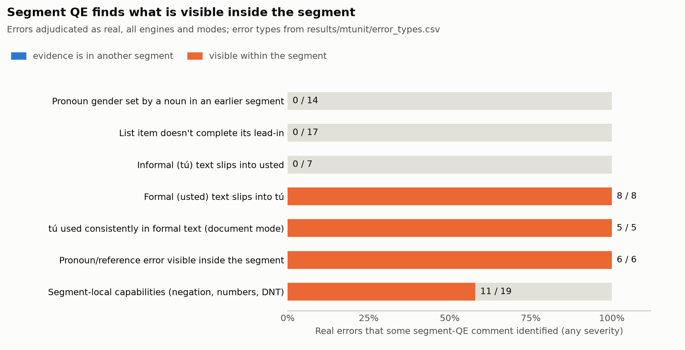

# What Segment-Level QE Can't See

[](https://github.com/Colton-Cogg-1999/translation-unit-tests/actions/workflows/ci.yml)

*An exploratory study of document-level translation errors, measured with AI-generated unit tests for
MT/LLM engines (English → Spanish).*

## Summary

Localization pipelines translate and quality-check text **one segment at a time**. Segment-level quality
estimation (QE) asks one question: *is this target a good translation of this source?* This study shows a
class of errors where the answer is "yes" for every segment, and the document is still wrong:

* A pronoun takes the wrong gender because its noun is in the previous segment.
* One sentence addresses the reader as *usted* while the rest of the text uses *tú*.
* A list item is a fine sentence alone but doesn't grammatically complete its lead-in.

QE can't catch these, however good the QE model is, because the information needed is in a segment it never
sees. They need checks over the whole document. This project writes those checks as **unit tests**: explicit
assertions about the translated document, such as "pronouns agree with their referents", "register is
consistent", "list items complete the lead-in" and "the maximum daily dose is preserved". It then measures
what they catch.

**Main findings**

1. **Segment QE missed every error whose evidence was in another segment.** In 14 cases a pronoun had the
   wrong gender for a noun in an earlier segment (e.g. *devuélvelo* referring to *la crema*): QE identified **0 of 14**.
   In 17 cases a list item didn't fit its lead-in: **0 of 17**. Across the three error types where the evidence
   is in another segment, QE identified 0 of 38; across the types visible inside the segment, 19 of 19.
2. **Segment QE judges formality against its own default, not against the document.** When formal (*usted*)
   text slipped into *tú*, QE flagged it 8 of 8 times, because *tú* looks too informal in isolation. When
   informal text slipped into *usted*, it flagged it 0 of 7 times, because a formal sentence looks fine alone.
3. **Segment-by-segment translation causes these errors.** Pooled over three engines, cross-segment tests
   passed 89% with whole-document translation and 69% segment by segment. Segment-local capabilities, the
   control group, were unchanged (92% vs 91%). The difference between the two effects is
   +19 percentage points (95% CI +10 to +28), and the direction was the same in all three engines.
4. **Unit tests are cheap to generate but need a second check.** An LLM-written suite of 92 cases cost about
   $10 to run. 102 of the 133 failures (77%) were confirmed real errors; the rest were over-specific assertions.

The numbers above, every table below and the figures are produced by [`analysis/`](analysis/) from the
committed results, and CI fails if the README and the results disagree.

## Correct segments, wrong document

All examples are real outputs from this study (segment-by-segment translation). Segment QE reported **no
errors** on every segment shown.

**Gender agreement across segments** (GPT-5.4 mini)

| # | source | translation | problem |
|---|---|---|---|
| 1 | Try our new moisturizing cream for 30 days. | Prueba nuestra nueva **crema** hidratante durante 30 días. | |
| 2 | If you don't love it, send it back. | Si no te encanta, **devuélvelo**. | *crema* is feminine → *devuélvela* |

| # | source | translation | problem |
|---|---|---|---|
| 1 | Our new sneakers are lightweight and breathable. | Nuestras nuevas **zapatillas** son ligeras y transpirables. | |
| 2 | Order them today, and they arrive tomorrow. | **Pídelos** hoy y te llegarán mañana. | *zapatillas* is feminine → *pídelas* |

Read alone, *Si no te encanta, devuélvelo* is a correct translation of *If you don't love it, send it back*.
The English source has no gender, so nothing in the segment tells QE that the pronoun is wrong.

**Formality drift** (Llama 4 Scout)

| # | source | translation | register |
|---|---|---|---|
| 1 | To change your language, open Settings. | Para cambiar tu idioma, **abre** Ajustes. | tú |
| 2 | Select Language and choose an option from the list. | **Seleccione** el idioma y **elija** una opción de la lista. | usted |
| 3 | If you need help, contact our support team. | Si **necesitas** ayuda, **ponte** en contacto con nuestro equipo de soporte. | tú |

**List items that don't complete the lead-in** (GPT-5.4 mini)

| # | source | translation | problem |
|---|---|---|---|
| 1 | Do not use the device if you: | No utilice el dispositivo si: | singular *usted* |
| 2 | are pregnant | **están embarazadas** | 3rd-person plural |
| 3 | have a pacemaker | tiene un marcapasos | ✓ |
| 4 | are allergic to nickel | **son alérgicos** al níquel | 3rd-person plural |

In this medical-device warning, items 2 and 4 address a different, plural subject. Each is grammatical on
its own.

## Unit tests vs. segment QE

The two methods answer different questions.

| | segment-level QE | document unit tests |
|---|---|---|
| question | Is this segment a good translation of its source? | Does the translated document meet these requirements? |
| input | one (source, target) pair ([`transtest/segqe.py`](transtest/segqe.py)) | the whole document, plus the requirements |
| output | error annotations and a score | pass/fail per requirement (JUnit XML, so it can run in CI) |
| can see | mistranslations, omissions and fluency problems inside a segment | agreement, consistency and coverage across segments; explicit requirements |
| cannot see | anything that depends on another segment | anything nobody wrote a test for |

Unit tests also let you state the **requirements that matter for a given text**, instead of relying on a
general quality score. The pilot study's patient-leaflet suite, for example, includes:

* *"You must not take more than 8 tablets (4,000 mg) in 24 hours"* (a critical meaning assertion)
* every number in the source appears correctly in the target (deterministic check)
* *tablet* is translated as *comprimido*, never *tableta/pastilla*, throughout the document (glossary and
  consistency)
* the reader is addressed with *usted* everywhere (register)
* *"What is the maximum daily dose for someone with liver problems?"* is answered correctly from the
  translation alone (a QA probe that combines information across sentences)

These are not alternatives to QE. Segment QE is good at what it can see, and it caught some meaning errors in
the pilot that the tests missed. The point is that some properties of a translation only exist at the document
level, and they need a check that looks at the document.

## Research questions

* **RQ1.** Compared with whole-document translation, does segment-by-segment translation lower pass rates on
  capabilities that need context beyond the segment, and leave segment-local capabilities unchanged?
* **RQ2.** When those failures occur, does segment-level QE detect them?
* **RQ3.** Can an LLM produce a usable capability test suite for translation, and how often are its
  assertions wrong?
* **Pilot.** Can a requirement-based test suite for one document act as a QA check on its translation, and
  can mutation testing measure how good that suite is?

## Method

**Capabilities.** Twelve capabilities were tested, in the style of
[CheckList](https://aclanthology.org/2020.acl-main.442/) behavioural testing, in two groups:

| segment-local (control) | cross-segment |
|---|---|
| negation · numbers & locale formats · placeholders/tags · do-not-translate terms · logical/condition scope | pronoun & gender agreement · terminology consistency · register consistency · implicit subjects/ellipsis · list items inheriting a lead-in · context-dependent word sense · UI-label references |

**Test generation and validation.**
* Claude Sonnet 5.5 generated 8 cases per capability, spread across software/UI, marketing, legal and medical
  text. Each case has 1–6 source segments and 1–3 assertions about the Spanish output. Assertions are either
  deterministic (`preserve`, `contains`, `not_contains`) or grounded LLM judgments: the judge must quote the
  translation, and a verdict whose quote isn't found in the output is discarded as unverified.
* Each case was translated whole-document by GPT-5.4 to produce a gold translation. Assertions that failed
  on the gold translation were dropped as wrong or too strict. **92/96 cases and 194/207 assertions** were kept.

**Engines and conditions.** Llama 4 Scout, GPT-5.4 nano and GPT-5.4 mini, each run in two modes:
* *segment*: one request per segment with no surrounding context, as a TMS sends text;
* *document*: all segments of a case in one request.

**Baseline QE.** Every output was also scored by MQM-style segment-level QE (Claude Sonnet 5.5, one segment
at a time, with a GEMBA-MQM-style prompt).

**Adjudication.** Every assertion failure was reviewed by GPT-5.4, which neither generated nor judged the
tests. It answered two questions: is this a real error a reviewer would fix, and did any segment-QE comment,
at any severity, describe the same problem?

**Error types.** For the three capabilities where QE's success depends on where the evidence is (pronoun
agreement, implicit subjects, register), each adjudicated real error was classified by error type from the
adjudicator's notes and the outputs. The labels are in
[`results/mtunit/error_types.csv`](results/mtunit/error_types.csv).

**Statistics** ([`analysis/stats.py`](analysis/stats.py)). Every engine translates the same 92 cases, so
rows that share a case are not independent. Confidence intervals come from a bootstrap that resamples whole
cases (10,000 replicates, stratified by capability). The RQ1 hypothesis is tested as an interaction in a GEE
logistic regression clustered by case. Paired comparisons use exact sign tests on discordant engine × case
pairs, with Holm correction across capabilities. A case passes if every assertion passes; 4 engine × mode × case rows
with an unverified judge verdict and no failure are excluded from pass rates.

The study was run once, at temperature 0, on 2026-11-15. Models, settings and a hash of every prompt are
recorded in [`results/mtunit/manifest.json`](results/mtunit/manifest.json).

## Results

### RQ1: Segmentation causes cross-segment failures

<picture>
  <source media="(prefers-color-scheme: dark)" srcset="figures/mode_effect-dark.png">
  
</picture>

Case pass rates by engine and mode:

<!-- BEGIN analysis:rq1_table -->
| capability | cross-segment | scout seg | scout doc | nano seg | nano doc | mini seg | mini doc |
|---|---|---|---|---|---|---|---|
| negation |  | 7/8 | 8/8 | 8/8 | 8/8 | 8/8 | 7/8 |
| numbers & locale formats |  | 5/8 | 5/8 | 7/8 | 7/8 | 8/8 | 8/8 |
| placeholders/tags |  | 8/8 | 8/8 | 8/8 | 8/8 | 8/8 | 8/8 |
| do-not-translate terms |  | 5/7 | 5/7 | 6/7 | 7/7 | 5/7 | 5/7 |
| logical/condition scope |  | 8/8 | 8/8 | 8/8 | 8/8 | 8/8 | 8/8 |
| pronoun & gender agreement | yes | 6/8 | 7/8 | 4/8 | 6/8 | 7/8 | 8/8 |
| terminology consistency | yes | 7/7 | 7/7 | 7/7 | 7/7 | 7/7 | 7/7 |
| register consistency | yes | 1/7 | 5/7 | 4/7 | 7/8 | 6/8 | 6/7 |
| implicit subjects/ellipsis | yes | 5/8 | 7/8 | 4/8 | 7/8 | 6/8 | 8/8 |
| list items inheriting a lead-in | yes | 3/8 | 8/8 | 5/8 | 8/8 | 4/8 | 8/8 |
| context-dependent word sense | yes | 6/8 | 6/8 | 7/8 | 8/8 | 8/8 | 8/8 |
| UI-label references | yes | 5/6 | 5/6 | 3/6 | 3/6 | 4/6 | 4/6 |
| **segment-local** | | **85%** | **87%** | **95%** | **97%** | **95%** | **92%** |
| **cross-segment** | | **63%** | **87%** | **65%** | **87%** | **79%** | **94%** |
<!-- END analysis:rq1_table -->

Document context raised cross-segment pass rates and left the control group unchanged. In the pooled comparison,
33 engine × case pairs failed only in segment mode and 4 only in document mode. In the regression, the
document × cross-segment interaction has an odds ratio of 3.3:

<!-- BEGIN analysis:rq1_tests -->
| | document − segment pass rate, 95% CI | failed only in segment mode | failed only in document mode | sign test |
|---|---|---|---|---|
| cross-segment capabilities | +20 pp [+11, +28] | 33 | 4 | p = 1×10⁻⁶ |
| segment-local capabilities | +1 pp [-3, +4] | 3 | 2 | p = 1.00 |
| **difference (cross − local)** | **+19 pp [+10, +28]** | | | |

GEE logistic regression on all 548 decided engine × mode × case rows, clustered by case (92 cases), with engine as a covariate:

| term | odds ratio [95% CI] | p |
|---|---|---|
| document mode (segment-local capabilities) | 1.1 [0.7, 1.8] | 0.64 |
| document mode (cross-segment capabilities) | 3.7 [1.9, 7.1] | 1×10⁻⁴ |
| **document × cross-segment interaction** | **3.3 [1.4, 7.4]** | **0.005** |
<!-- END analysis:rq1_tests -->

* The largest effects were in **list inheritance**, **register** and **implicit subjects**: the capabilities
  where Spanish grammar depends on an earlier segment. With 6–8 cases per capability the per-capability
  intervals are wide, and after Holm correction only list inheritance stays significant (Holm-adjusted p = 0.006).
* The weaker the engine, the more it lost: segmentation cost Scout 23 points, nano 21 and mini 15 on the
  cross-segment capabilities.
* Two cross-segment capabilities showed no effect. *Terminology consistency* never failed, which suggests the
  generated cases were too easy. *UI-label references* scored the same in both modes.

<details>
<summary>Per-capability effects</summary>

<!-- BEGIN analysis:rq1_caps -->
| capability | document − segment, 95% CI | failed only seg / only doc | sign test p (Holm) |
|---|---|---|---|
| pronoun & gender agreement | +17 pp [-4, +38] | 5 / 1 | 1.00 |
| terminology consistency | +0 pp [+0, +0] | 0 / 0 | 1.00 |
| register consistency | +32 pp [+5, +60] | 6 / 1 | 1.00 |
| implicit subjects/ellipsis | +29 pp [+0, +58] | 8 / 1 | 0.43 |
| list items inheriting a lead-in | +50 pp [+21, +79] | 12 / 0 | 0.006 |
| context-dependent word sense | +4 pp [-12, +25] | 2 / 1 | 1.00 |
| UI-label references | +0 pp [+0, +0] | 0 / 0 | 1.00 |
| negation *(control)* | +0 pp [-12, +12] | 1 / 1 | 1.00 |
| numbers & locale formats *(control)* | +0 pp [-12, +12] | 1 / 1 | 1.00 |
| placeholders/tags *(control)* | +0 pp [+0, +0] | 0 / 0 | 1.00 |
| do-not-translate terms *(control)* | +5 pp [+0, +14] | 1 / 0 | 1.00 |
| logical/condition scope *(control)* | +0 pp [+0, +0] | 0 / 0 | 1.00 |
<!-- END analysis:rq1_caps -->

</details>

### RQ2: Segment QE misses what it can't see

Of the 133 assertion failures, the adjudicator confirmed 102 as real errors. Whether QE noticed them depends on
where the evidence is:

<picture>
  <source media="(prefers-color-scheme: dark)" srcset="figures/qe_detection-dark.png">
  
</picture>

<!-- BEGIN analysis:rq2_types -->
| error type | evidence is… | real errors | QE identified |
|---|---|---|---|
| Pronoun gender set by a noun in an earlier segment | another segment | 14 | **0** |
| List item doesn't complete its lead-in | another segment | 17 | **0** |
| Informal (tú) text slips into usted | another segment | 7 | **0** |
| Formal (usted) text slips into tú | inside the segment | 8 | **8** |
| tú used consistently in formal text (document mode) | inside the segment | 5 | **5** |
| Pronoun/reference error visible inside the segment | inside the segment | 6 | **6** |
| Segment-local capabilities (negation, numbers, DNT) | inside the segment | 19 | **11** |
<!-- END analysis:rq2_types -->

* **Pronoun agreement.** Every wrong-gender pronoun whose noun was in an earlier segment went unnoticed.
  The 6 pronoun errors QE did identify were visible inside the segment: a mistranslated sentence, an added
  pronoun, plural *them* rendered as singular, and an awkward neuter *lo último*.
* **Register.** QE's register comments were all of one kind: *tú* is informal for legal or patient text. That
  catches formal text slipping into *tú*, and it also flags documents that use *tú* consistently (5 cases,
  all from document mode). It never catches informal text slipping into *usted*. None of the register comments
  was rated major.
* **List inheritance.** Each item is a well-formed fragment on its own, so QE has nothing to flag.

The capability-level split is less sharp than the error-type split. Counting every real error in the
cross-segment capabilities, QE identified 36 of 83 (43%), against 11 of 19 (58%) in the segment-local
capabilities (Fisher p = 0.31). The cross-segment capabilities also contain errors that are visible inside a
segment, such as the 6 pronoun errors and the formal-to-*tú* slips above, and the UI-label and word-sense
errors were not classified by error type. At the major/critical
threshold, QE flagged 2 of 19 segment-local errors and 12 of 83 cross-segment errors, so on its own severity
scale QE rated most real errors of both kinds as minor or not at all.

<details>
<summary>By capability</summary>

<!-- BEGIN analysis:rq2_table -->
| capability | real errors | QE identified (any severity) | QE major/critical flag in the case |
|---|---|---|---|
| pronoun & gender agreement | 11 | 2 | 1 |
| register consistency | 22 | 13 | 1 |
| implicit subjects/ellipsis | 11 | 4 | 2 |
| list items inheriting a lead-in | 17 | 0 | 1 |
| context-dependent word sense | 5 | 5 | 3 |
| UI-label references | 17 | 12 | 4 |
| negation *(control)* | 2 | 2 | 2 |
| numbers & locale formats *(control)* | 8 | 4 | 0 |
| do-not-translate terms *(control)* | 9 | 5 | 0 |
| **cross-segment total** | **83** | **36 (43%)** | **12 (14%)** |
| **segment-local total** | **19** | **11 (58%)** | **2 (11%)** |
<!-- END analysis:rq2_table -->

*QE identified* = some QE comment at any severity described the same problem (adjudicator's judgement).
*Major/critical flag* = QE rated at least one segment of the case major or critical.
</details>

QE also flagged at least one segment as major/critical in 10 of the 464 cases that passed every test (QE noise,
or issues outside the tested capabilities).

### RQ3: Reliability of generated tests

<picture>
  <source media="(prefers-color-scheme: dark)" srcset="figures/artifact_rate-dark.png">
  
</picture>

* Validation removed 4 of 96 cases and 13 of 207 assertions that failed even on the gold translation.
* Of the 133 failures that remained, 31 (23%) were test artifacts. They were mostly assertions narrower than
  the range of correct translations, for example requiring *Iniciar* where *Inicio* is equally correct. A
  single gold translation can't expose that kind of over-specification.
* Reliability varied by capability. Word-sense, UI-label and do-not-translate assertions produced the most
  artifacts; list-inheritance assertions produced none.
* Generated suites are cheap and catch real errors, but their failures need a second review (here an
  independent model; in production, a quick human look) before they are acted on.

<details>
<summary>By capability</summary>

<!-- BEGIN analysis:rq3_table -->
| capability | failures | test artifacts | real errors |
|---|---|---|---|
| pronoun & gender agreement | 15 | 4 | 11 |
| register consistency | 24 | 2 | 22 |
| implicit subjects/ellipsis | 15 | 4 | 11 |
| list items inheriting a lead-in | 17 | 0 | 17 |
| context-dependent word sense | 9 | 4 | 5 |
| UI-label references | 27 | 10 | 17 |
| negation | 2 | 0 | 2 |
| numbers & locale formats | 10 | 2 | 8 |
| do-not-translate terms | 14 | 5 | 9 |
| **total** | **133** | **31 (23%)** | **102 (77%)** |
<!-- END analysis:rq3_table -->

</details>

Raw material: per-engine runs and JUnit XML in [`results/mtunit/runs/`](results/mtunit/runs/) and
[`results/mtunit/junit/`](results/mtunit/junit/), adjudications in
[`results/mtunit/adjudication.json`](results/mtunit/adjudication.json), all computed statistics in
[`results/analysis/summary.json`](results/analysis/summary.json).

## Pilot study: Requirement tests for one document (`transtest/`)

Before the main study, a smaller exploration used a hand-written suite of requirement tests for a single
document (a fictional patient leaflet) and ran it against its Spanish translation.

* **Planted errors.** The leaflet was given 9 planted errors, each in fluent, grammatical Spanish. The suite
  caught **8/9** with no false alarms on the correct translation. LLM segment QE caught 7/9. The two it missed were
  the errors that are invisible one sentence at a time: *tablet* translated three different ways, and a
  switch from *usted* to *tú* midway through. LaBSE similarity caught 2/9. QE caught one meaning error the suite
  missed: "avoid alcohol" softened to "avoid alcohol *in excess*".
* **Mutation testing.** To measure how good the suite was, 14 single-edit mutants of a correct translation
  were created. The first version of the suite scored 0.71 and let *"No tome más de 8 comprimidos"* →
  *"Tome más de 8 comprimidos"* survive, deleting the "not" from a dosing limit. Three added tests raised the
  score to 0.86. The only survivors were two *y* → *o* swaps that barely change the meaning (*fuera de la
  vista o del alcance de los niños*).
* **Real MT.** Translating sentence by sentence, a small local model (Qwen3-4B) mixed *comprimidos /
  tabletas / pastillas* and switched to *tú* in 6 sentences, and the suite flagged both. GPT-5.4 mini produced
  clean output in both modes.

This was a single document, used for illustration. It motivated the larger generated-suite design above. Its
outputs are committed in [`results/transtest/`](results/transtest/) as the record. Unlike the main study, it
can't be replayed from the cache, because the pilot code changed after those runs.

## Related work

* **Behavioural testing.** The capability-and-assertion design follows CheckList (Ribeiro et al., 2020),
  applied here to translation, with the test cases generated by an LLM instead of templates.
* **Context-dependent translation.** Contrastive test sets measure whether MT models use context for
  pronouns, deixis, ellipsis and lexical cohesion: ContraPro (Müller et al., 2018), Bawden et al. (2018),
  and Voita et al. (2019), whose title, *When a Good Translation is Wrong in Context*, is this study's
  premise. MuDA (Fernandes et al., 2023) and ctxpro (Wicks & Post, 2023) identify which phenomena need context
  in which languages, including Spanish formality and gender. Those resources score a model's choice between
  given translations; this study asserts properties of a free translation and compares the result with what
  QE reports.
* **Document-level evaluation.** Läubli et al. (2018) showed that human raters judging sentences in isolation
  miss differences that document-level raters see. Vernikos et al. (2022) extend sentence-level metrics with
  context. Segment-level QE such as GEMBA-MQM (Kocmi & Federmann, 2023) and CometKiwi (Rei et al., 2022) scores
  one segment at a time.
* **LLM judges.** LLM evaluators can favour their own generations (Panickssery et al., 2024) and show position
  and verbosity biases (Zheng et al., 2023). This is why the adjudicator here is from a different model family
  than the test generator and judge (see Limitations).

## Limitations

* **No human annotation.** Real-error and QE-identified labels come from one LLM adjudicator (GPT-5.4).
  The error-type labels in RQ2 were assigned after the fact, by an LLM-assisted pass over the adjudicator's
  notes and the outputs, and were not independently verified. The type-level contrast (0 of 38 vs 19 of 19)
  is large, but it rests on those labels.
* **Model families overlap.** The test generator, assertion judge and QE model are the same model (Claude
  Sonnet 5.5). The gold translation and the adjudicator are GPT-5.4, which is also the family of two of the
  three engines. Validating assertions against a GPT-5.4 translation likely favours GPT-family outputs,
  especially in document mode.
* **Single gold translation** for validation, which is why over-specific assertions got through.
* **One language pair** (EN→ES). Spanish gender and register make cross-segment effects easy to see. The
  structural argument applies to any language with agreement or formality distinctions, but the rates will
  differ.
* **LLM engines only.** Classic NMT engines (DeepL, Google) were not tested.
* **Small suite.** 92 cases, 6–8 per capability, one run. Pooled effects are clear; most per-capability
  effects are not individually significant.
* **QE was given no context.** The baseline is segment QE as it is usually run. QE given neighbouring segments
  might catch some of these errors; that was not tested.
* **Segment-mode baseline is strict.** Production TMS pipelines sometimes pass neighbouring segments to the
  engine. This setup measures the case with no context at all.

## Reproducing

Everything below runs without an API key or a GPU.

```bash
uv sync
uv run python -m analysis            # recompute every number, table and figure from results/
uv run python -m analysis --check    # verify the README matches the results
uv run pytest
```

To replay the whole study from the shipped LLM responses (about 2,300 cached calls, 270 KB), with no API
calls:

```bash
uv run python -m common.cache restore                        # results/cache/ → .cache/llm_cache.sqlite
rm results/mtunit/suite*.json results/mtunit/validation.json # regenerate the suite too
L10N_OFFLINE=1 uv run python -m mtunit.run
L10N_OFFLINE=1 uv run python -m mtunit.adjudicate
git diff --stat results/                                     # empty: byte-identical outputs
```

`L10N_OFFLINE=1` answers only from the cache and stops on any request that isn't there. CI runs this replay
on every push.

To run it fresh against live models (about $10 through OpenRouter):

```bash
cp .env.example .env            # OpenRouter key, or any OpenAI-compatible endpoint
uv run python -m common.check   # one small call per configured model
uv run python -m mtunit.run --per-cap 8 --engines openai/gpt-5.4-mini,meta-llama/llama-4-scout
uv run python -m mtunit.adjudicate
uv run python -m analysis
```

The pilot study's commands (its coverage check embeds text locally, so install the extra first):

```bash
uv sync --extra pilot
uv run python -m transtest calibrate transtest/examples/leaflet/suite.yaml
uv run python -m transtest run transtest/examples/leaflet/suite.yaml transtest/examples/leaflet/target_flawed.es.md
uv run python -m transtest mutate transtest/examples/leaflet/suite.yaml transtest/examples/leaflet/target_good.es.md
```

## Repository layout

```
mtunit/      main study: capabilities, test generation + validation, engines, assertions, run, adjudicate
analysis/    recomputes every reported number, table and figure from results/ (no LLM calls)
transtest/   pilot study: per-document checks, runner/CLI, mutation testing, segment QE,
             examples/leaflet (fictional leaflet with good + flawed Spanish, suite.yaml), experiments/
common/      OpenAI-compatible client with disk cache and offline mode, cache export/restore, run manifest
results/     mtunit/ (main study), analysis/ (computed statistics), transtest/ (pilot), cache/ (LLM responses)
figures/     README figures, light and dark
tests/       unit tests; no network
```

## References

* Bawden, Sennrich, Birch & Haddow. *Evaluating Discourse Phenomena in Neural Machine Translation.* NAACL 2018.
* Fernandes, Yin, Liu, Martins & Neubig. *When Does Translation Require Context? A Data-driven, Multilingual Exploration.* ACL 2023.
* Kocmi & Federmann. *GEMBA-MQM: Detecting Translation Quality Error Spans with GPT-4.* WMT 2023.
* Läubli, Sennrich & Volk. *Has Machine Translation Achieved Human Parity? A Case for Document-level Evaluation.* EMNLP 2018.
* Lommel, Uszkoreit & Burchardt. *Multidimensional Quality Metrics (MQM).* Tradumàtica 2014.
* Müller, Rios, Voita & Sennrich. *A Large-Scale Test Set for the Evaluation of Context-Aware Pronoun Translation in Neural Machine Translation.* WMT 2018.
* Panickssery, Bowman & Feng. *LLM Evaluators Recognize and Favor Their Own Generations.* NeurIPS 2024.
* Rei et al. *CometKiwi: IST-Unbabel 2022 Submission for the Quality Estimation Shared Task.* WMT 2022.
* Ribeiro, Wu, Guestrin & Singh. *Beyond Accuracy: Behavioral Testing of NLP Models with CheckList.* ACL 2020.
* Vernikos, Thompson, Mathur & Federico. *Embarrassingly Easy Document-Level MT Metrics.* WMT 2022.
* Voita, Sennrich & Titov. *When a Good Translation is Wrong in Context: Context-Aware Machine Translation Improves on Deixis, Ellipsis, and Lexical Cohesion.* ACL 2019.
* Wicks & Post. *Identifying Context-Dependent Translations for Evaluation Set Production.* WMT 2023.
* Zheng et al. *Judging LLM-as-a-Judge with MT-Bench and Chatbot Arena.* NeurIPS 2023.

## License

MIT
