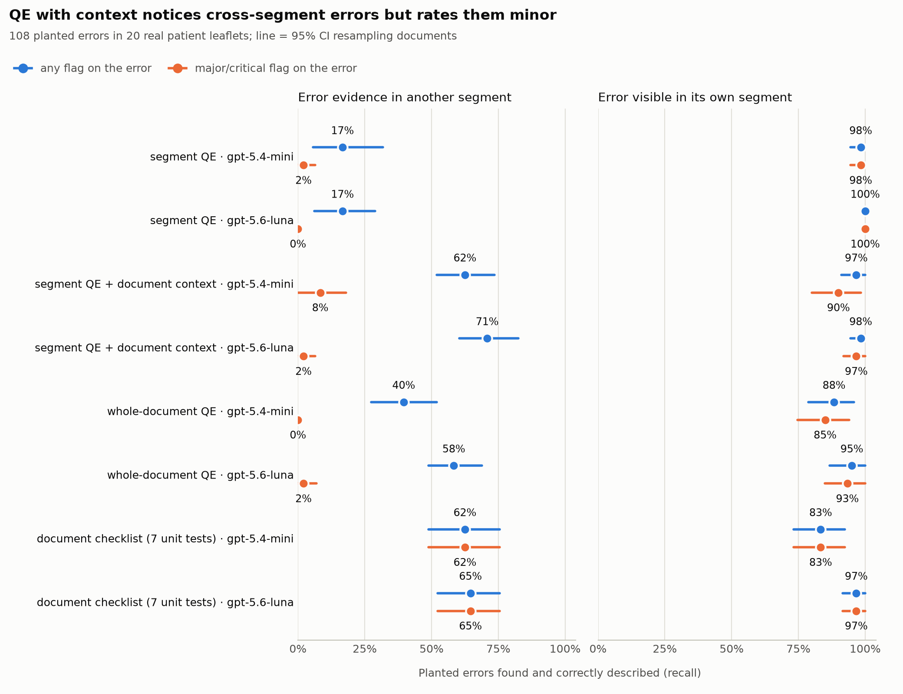
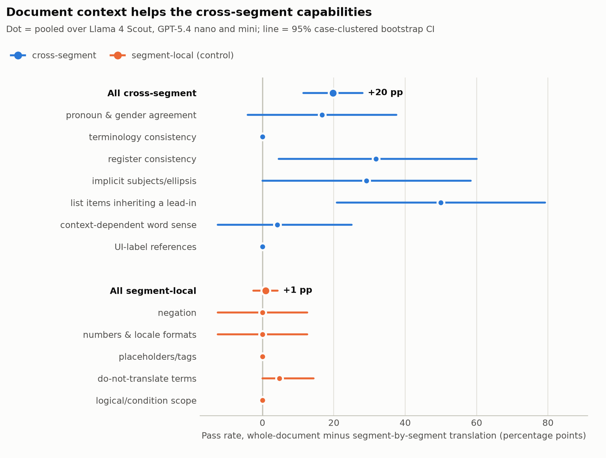
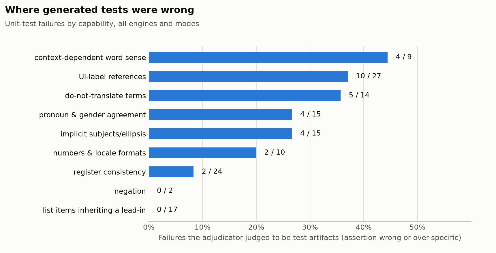

# What Segment-Level QE Can't See

[](https://github.com/Colton-Cogg-1999/translation-unit-tests/actions/workflows/ci.yml)

*Two studies of document-level translation errors (English → Spanish): which ones quality checks miss, why,
and what it costs to catch them.*

## Summary

Localization pipelines translate and quality-check text **one segment at a time**. Segment-level quality
estimation (QE) asks whether each target segment is a good translation of its source. Some errors pass that test
in every segment and still leave the document wrong:

* a pronoun takes the wrong gender because its noun is in another segment;
* one sentence addresses the reader as *tú* in a leaflet that otherwise uses *usted*;
* a list item is grammatical alone but doesn't complete its lead-in.

**Study A** plants 108 errors with known locations into 20 real EU patient leaflets with professional Spanish
translations, and measures what four kinds of check find with two models (gpt-5.4-mini and gpt-5.6-luna), how often
they raise false alarms, and what they cost. **Study B** generates capability unit tests for three MT/LLM engines and
measures where segment-by-segment translation fails and whether segment QE notices.

**Findings**

1. **Segment QE misses errors whose evidence is in another segment.** It found 8 of 48 planted cross-segment errors (17%) with either model,
   against 59 and 60 of 60 errors visible in their own segment.
2. **Given the whole document, QE finds them but rates them minor.** With the leaflet as context, QE
   found 30 of 48 (gpt-5.4-mini) and 34 of 48 (gpt-5.6-luna) cross-segment errors, but
   flagged only 4 and 1 of them as major or critical. A pipeline that acts on major/critical flags would let
   more than 90% of these errors through. Full GPT-5.4 showed the same gap in the pilot.
3. **A better model finds more but still rates them minor.** gpt-5.6-luna found more cross-segment errors than
   gpt-5.4-mini with context (71% vs 62%) and as whole-document QE (58% vs 40%), but with context it
   rated 1 of 48 major. The gap is in how QE judges severity, not in model size.
4. **A seven-check document checklist closes the gap.** Run alongside segment QE, it raised cross-segment errors
   flagged major/critical from 1 to 30 of 48 (gpt-5.4-mini) and from 0 to 31 of 48 (gpt-5.6-luna). It
   kept 98% and 100% of segment-local errors. Clean segments flagged major/critical rose
   from 15% to 18% and from 16% to 22%. At list price it costs
   $0.15 instead of $0.10 per 100 segments with gpt-5.4-mini, and
   $0.05 instead of $0.03 with gpt-5.6-luna (half that through the Batch API).
5. **Agreement and terminology errors stay hard.** The best check
   found 6 of 12 agreement errors and 7 of 12 inconsistent terms.
6. **Segmentation causes these errors.** In study B, cross-segment unit tests passed 89% with
   whole-document translation and 69% segment by segment, while segment-local capabilities were unchanged
   (92% vs 91%).

<picture>
  <source media="(prefers-color-scheme: dark)" srcset="figures/bench_recall-dark.png">
  
</picture>

**What this means in practice.** Keep segment QE for errors inside a segment, but don't rely on its severity labels
to catch document-level errors, even when it is given context, and even with a newer model. Add a short list of
document-level unit tests (agreement, form of address, terminology, list fit, numbers, logic, meaning), each
returning pass/fail with a quoted span. With gpt-5.6-luna both together cost a few cents per 100 segments.
Terminology consistency and pronoun agreement still need more than an LLM pass, for example a deterministic
glossary check for terminology.

All numbers, tables and figures in this README are recomputed from the committed results by
[`analysis/`](analysis/), and CI fails if they disagree. Both studies replay offline from shipped LLM responses.

## Study A: planted errors in real documents (`benchmark/`)

### Design

**Documents.** 20 EU patient information leaflets (sections 1–5, 39–60 segments, 1,012 segments in all) with
their professional Spanish translations, from the OPUS EMEA corpus. A leaflet was kept only if every line pair
was a plausible translation by embedding similarity, so the sentence alignment can be trusted.

**Planted errors.** GPT-5.5 proposed single-segment edits of nine types. Each edit had to leave the segment fluent,
grammatical Spanish. A separate GPT-5.5 call then verified each edit with a fresh prompt: exactly one error of the
claimed type, fluent on its own, and, for cross-segment types, *not* detectable from the segment and its own source
alone. 12 verified edits per type were kept, spread across documents, giving **108 variants**, each a leaflet with
one known error.

| evidence in another segment | evidence in the same segment (controls) |
|---|---|
| agreement · register (*usted*/*tú*) · terminology · list fit | negation · number · omission · mistranslation · condition |

**Checks compared**, each run with gpt-5.4-mini (standard API) and gpt-5.6-luna (Batch API), low reasoning effort;
prompts in [`benchmark/detectors.py`](benchmark/detectors.py):

| check | what it sees | calls |
|---|---|---|
| segment QE | one (source, target) pair; the MQM prompt from study B | one per segment |
| segment QE + document context | the same judgement of one segment, with the whole document in the prompt | one per segment |
| whole-document QE | the whole document; lists every error with segment numbers | one per document |
| document checklist | the whole document; 7 fixed requirements, each a separate pass/fail call that must quote its evidence | seven per document |

**Scoring.** A planted error counts as found only if a check flags the edited segment **and** an independent model
(GPT-5.4) confirms the flag describes the planted change rather than something else in that segment. False alarms
are measured on the unmodified leaflets: every segment for the document-level checks, and a fixed sample of 12
segments per leaflet for the per-segment checks. Confidence intervals resample whole documents. Cost is computed
from the token usage recorded during the run, at OpenAI's standard list prices.

### Results

Combinations of checks, by what a pipeline that acts on major/critical flags would catch:

<!-- BEGIN analysis:bench_stacks -->
| model | checks run | cross-segment errors, any flag | cross-segment errors, major/critical flag | segment-local errors, major/critical flag | clean segments flagged major/critical | cost per 100 segments |
|---|---|---|---|---|---|---|
| gpt-5.4-mini | segment QE alone | 17% [6–32] | **2% [0–6]** | 98% [95–100] | 15% | $0.10 |
| gpt-5.4-mini | segment QE + checklist | 65% [50–78] | **62% [49–76]** | 98% [95–100] | 18% | $0.15 |
| gpt-5.4-mini | context QE alone | 62% [52–73] | **8% [0–18]** | 90% [80–98] | 10% | $0.22 |
| gpt-5.4-mini | context QE + checklist | 69% [56–81] | **62% [49–76]** | 93% [85–100] | 12% | $0.28 |
| gpt-5.6-luna | segment QE alone | 17% [6–29] | **0% [0–0]** | 100% [100–100] | 16% | $0.03 |
| gpt-5.6-luna | segment QE + checklist | 71% [60–82] | **65% [52–76]** | 100% [100–100] | 22% | $0.05 |
| gpt-5.6-luna | context QE alone | 71% [60–82] | **2% [0–6]** | 97% [92–100] | 7% | $0.08 |
| gpt-5.6-luna | context QE + checklist | 81% [71–91] | **65% [52–76]** | 98% [95–100] | 14% | $0.10 |
<!-- END analysis:bench_stacks -->

Each check alone:

<!-- BEGIN analysis:bench_recall -->
| detector | model | cross-segment errors | segment-local errors |
|---|---|---|---|
| segment QE | gpt-5.4-mini | 17% [6–32] | 98% [95–100] |
| segment QE | gpt-5.6-luna | 17% [6–29] | 100% [100–100] |
| segment QE + document context | gpt-5.4-mini | 62% [52–73] | 97% [91–100] |
| segment QE + document context | gpt-5.6-luna | 71% [60–82] | 98% [95–100] |
| whole-document QE | gpt-5.4-mini | 40% [27–52] | 88% [79–96] |
| whole-document QE | gpt-5.6-luna | 58% [49–69] | 95% [87–100] |
| document checklist (7 unit tests) | gpt-5.4-mini | 62% [49–76] | 83% [73–92] |
| document checklist (7 unit tests) | gpt-5.6-luna | 65% [52–76] | 97% [92–100] |
<!-- END analysis:bench_recall -->

* **Context is what finds cross-segment errors.** QE with context
  found 23 (gpt-5.4-mini) and 27 (gpt-5.6-luna) errors that plain segment QE missed,
  against 1 the other way (McNemar p < 0.001 for both). QE with context and the checklist found similar numbers
  (McNemar p > 0.5 for both models).
* **Severity is where QE fails.** QE with context described the register slip, the wrong pronoun or the plural
  list item correctly, and then rated it minor. The checklist has no severity: a requirement holds or it doesn't.
* **Whole-document QE in one call is the cheapest and quietest check but shallow.** It
  found 40% (gpt-5.4-mini) and 58% (gpt-5.6-luna) of cross-segment errors and rated almost none of them major.
* **The checklist with gpt-5.4-mini is weaker on local errors** (83%, mainly omissions and condition changes);
  with gpt-5.6-luna it reaches 97%.

By error type (share found, any flag):

<!-- BEGIN analysis:bench_types -->
| error type | evidence | n | segment QE | segment QE + document context | whole-document QE | document checklist (7 unit tests) |
|---|---|---|---|---|---|---|
| agreement | other segment | 12 | 17% / 17% | 33% / 25% | 17% / 25% | 33% / 50% |
| register | other segment | 12 | 33% / 0% | 100% / 100% | 92% / 100% | 100% / 100% |
| terminology | other segment | 12 | 0% / 8% | 17% / 58% | 0% / 25% | 17% / 17% |
| list_fit | other segment | 12 | 17% / 42% | 100% / 100% | 50% / 83% | 100% / 92% |
| negation | same segment | 12 | 100% / 100% | 100% / 100% | 100% / 100% | 100% / 100% |
| number | same segment | 12 | 100% / 100% | 100% / 100% | 100% / 100% | 100% / 100% |
| omission | same segment | 12 | 100% / 100% | 100% / 100% | 75% / 92% | 58% / 92% |
| mistranslation | same segment | 12 | 100% / 100% | 100% / 100% | 100% / 100% | 92% / 100% |
| condition | same segment | 12 | 92% / 100% | 83% / 92% | 67% / 83% | 67% / 92% |

Each cell: gpt-5.4-mini / gpt-5.6-luna.
<!-- END analysis:bench_types -->

False alarms on the unmodified leaflets and cost:

<!-- BEGIN analysis:bench_false_alarms -->
| detector | model | clean segments flagged, any severity | major/critical | cost per 100 segments (leaflets) |
|---|---|---|---|---|
| segment QE | gpt-5.4-mini | 32% | 15% | $0.10 |
| segment QE | gpt-5.6-luna | 36% | 16% | $0.03 |
| segment QE + document context | gpt-5.4-mini | 26% | 10% | $0.22 |
| segment QE + document context | gpt-5.6-luna | 30% | 7% | $0.08 |
| whole-document QE | gpt-5.4-mini | 9% | 4% | $0.01 |
| whole-document QE | gpt-5.6-luna | 18% | 6% | $0.005 |
| document checklist (7 unit tests) | gpt-5.4-mini | 11% | 11% | $0.05 |
| document checklist (7 unit tests) | gpt-5.6-luna | 15% | 15% | $0.02 |
<!-- END analysis:bench_false_alarms -->

These "false alarms" are flags on professional translations as published; some may be real issues in the reference
translations rather than noise.

<details>
<summary>Examples: QE with context sees the error and rates it minor (gpt-5.4-mini)</summary>

All from the run; segment QE reported no error on the edited segment in each case.

| planted edit | QE with context (severity: minor) | checklist |
|---|---|---|
| *Informe a su médico…* → *Informa a **tu** médico si **estás** utilizando…* | "El uso de la forma informal 'tu' rompe la uniformidad del prospecto…" | register: "uses the informal form while the rest of the addressed text uses the formal usted" |
| *No tome una dosis doble…* → *No **tomen** una dosis doble…* | "the translation uses the plural form 'tomen'…" | register: "plural 'tomen' instead of the consistent 'usted' form used elsewhere" |
| *• si usted tiene una infección…* → *• si **ustedes tienen** una infección…* | "El uso de «ustedes» es poco natural e inconsistente con el tono del prospecto…" | register: "plural 'ustedes' while the rest addresses the reader in the singular" |
| *…para protegerlo de la luz* → *…para **protegerla** de la luz* | "El pronombre no concuerda con el antecedente…" | agreement: "-la does not agree in gender with its antecedent" |

</details>

**Does a larger model change this?** The 51-error pilot (2 leaflets, 2 short texts) also ran full GPT-5.4. On
its 13 cross-segment errors, GPT-5.4 with context found 11 of 13 and rated 1 of 13 major or critical:

<!-- BEGIN analysis:bench_pilot -->
| detector | gpt-5.4: any flag | gpt-5.4: major/critical | gpt-5.4-mini: any flag | gpt-5.4-mini: major/critical |
|---|---|---|---|---|
| segment QE | 4/13 | 0/13 | 2/13 | 0/13 |
| segment QE + document context | 11/13 | 1/13 | 7/13 | 0/13 |
| whole-document QE | 10/13 | 3/13 | 6/13 | 0/13 |
| document checklist (7 unit tests) | 6/13 | 6/13 | 7/13 | 7/13 |
<!-- END analysis:bench_pilot -->

## Study B: unit tests for MT engines (`mtunit/`)

**Question.** Does segment-by-segment translation (as a TMS sends text) cause cross-segment errors, and does
segment QE notice them?

**Method.** Claude Sonnet 5.5 generated 8 test cases for each of 12 capabilities, in the style of
[CheckList](https://aclanthology.org/2020.acl-main.442/): 5 segment-local controls (negation, numbers, placeholders,
do-not-translate terms, logical scope) and 7 cross-segment capabilities (pronoun agreement, terminology and register
consistency, implicit subjects, list items, word sense, UI-label references). Each case has 1–4 segments and 1–3
assertions: deterministic string checks, or LLM judgements that must quote the output. Assertions that failed on a
whole-document GPT-5.4 translation were dropped (**92/96 cases and 194/207 assertions** kept). Llama 4 Scout, GPT-5.4
nano and GPT-5.4 mini translated every case segment by segment and as a whole document. Every output was scored by
segment QE (Claude Sonnet 5.5, MQM). Every failure was adjudicated by GPT-5.4: real error or test artifact, and did any
QE comment describe it?

### Segmentation causes cross-segment failures

<picture>
  <source media="(prefers-color-scheme: dark)" srcset="figures/mode_effect-dark.png">
  
</picture>

Cross-segment cases passed 89% with whole-document translation and 69% segment by segment; segment-local cases were
unchanged (92% vs 91%). 33 engine × case pairs failed only in segment mode and 4 only in document mode. The
difference between the two effects is +19 percentage points (95% CI +10 to +28); in a GEE logistic regression
clustered by case, the document × cross-segment interaction has an odds ratio of 3.3:

<!-- BEGIN analysis:rq1_tests -->
| | document − segment pass rate, 95% CI | failed only in segment mode | failed only in document mode | sign test |
|---|---|---|---|---|
| cross-segment capabilities | +20 pp [+11, +28] | 33 | 4 | p = 1×10⁻⁶ |
| segment-local capabilities | +1 pp [-3, +4] | 3 | 2 | p = 1.00 |
| **difference (cross − local)** | **+19 pp [+10, +28]** | | | |

GEE logistic regression on all 548 decided engine × mode × case rows, clustered by case (92 cases), with engine as a covariate:

| term | odds ratio [95% CI] | p |
|---|---|---|
| document mode (segment-local capabilities) | 1.1 [0.7, 1.8] | 0.64 |
| document mode (cross-segment capabilities) | 3.7 [1.9, 7.1] | 1×10⁻⁴ |
| **document × cross-segment interaction** | **3.3 [1.4, 7.4]** | **0.005** |
<!-- END analysis:rq1_tests -->

The largest effects were in list inheritance, register and implicit subjects. With 6–8 cases per capability,
only list inheritance stays significant (Holm-adjusted p = 0.006) on its own. The weaker the engine, the more it lost:
segmentation cost Scout 23 points, nano 21 and mini 15 on cross-segment capabilities.

<details>
<summary>Pass rates and effects by capability</summary>

<!-- BEGIN analysis:rq1_table -->
| capability | cross-segment | scout seg | scout doc | nano seg | nano doc | mini seg | mini doc |
|---|---|---|---|---|---|---|---|
| negation |  | 7/8 | 8/8 | 8/8 | 8/8 | 8/8 | 7/8 |
| numbers & locale formats |  | 5/8 | 5/8 | 7/8 | 7/8 | 8/8 | 8/8 |
| placeholders/tags |  | 8/8 | 8/8 | 8/8 | 8/8 | 8/8 | 8/8 |
| do-not-translate terms |  | 5/7 | 5/7 | 6/7 | 7/7 | 5/7 | 5/7 |
| logical/condition scope |  | 8/8 | 8/8 | 8/8 | 8/8 | 8/8 | 8/8 |
| pronoun & gender agreement | yes | 6/8 | 7/8 | 4/8 | 6/8 | 7/8 | 8/8 |
| terminology consistency | yes | 7/7 | 7/7 | 7/7 | 7/7 | 7/7 | 7/7 |
| register consistency | yes | 1/7 | 5/7 | 4/7 | 7/8 | 6/8 | 6/7 |
| implicit subjects/ellipsis | yes | 5/8 | 7/8 | 4/8 | 7/8 | 6/8 | 8/8 |
| list items inheriting a lead-in | yes | 3/8 | 8/8 | 5/8 | 8/8 | 4/8 | 8/8 |
| context-dependent word sense | yes | 6/8 | 6/8 | 7/8 | 8/8 | 8/8 | 8/8 |
| UI-label references | yes | 5/6 | 5/6 | 3/6 | 3/6 | 4/6 | 4/6 |
| **segment-local** | | **85%** | **87%** | **95%** | **97%** | **95%** | **92%** |
| **cross-segment** | | **63%** | **87%** | **65%** | **87%** | **79%** | **94%** |
<!-- END analysis:rq1_table -->

<!-- BEGIN analysis:rq1_caps -->
| capability | document − segment, 95% CI | failed only seg / only doc | sign test p (Holm) |
|---|---|---|---|
| pronoun & gender agreement | +17 pp [-4, +38] | 5 / 1 | 1.00 |
| terminology consistency | +0 pp [+0, +0] | 0 / 0 | 1.00 |
| register consistency | +32 pp [+5, +60] | 6 / 1 | 1.00 |
| implicit subjects/ellipsis | +29 pp [+0, +58] | 8 / 1 | 0.43 |
| list items inheriting a lead-in | +50 pp [+21, +79] | 12 / 0 | 0.006 |
| context-dependent word sense | +4 pp [-12, +25] | 2 / 1 | 1.00 |
| UI-label references | +0 pp [+0, +0] | 0 / 0 | 1.00 |
| negation *(control)* | +0 pp [-12, +12] | 1 / 1 | 1.00 |
| numbers & locale formats *(control)* | +0 pp [-12, +12] | 1 / 1 | 1.00 |
| placeholders/tags *(control)* | +0 pp [+0, +0] | 0 / 0 | 1.00 |
| do-not-translate terms *(control)* | +5 pp [+0, +14] | 1 / 0 | 1.00 |
| logical/condition scope *(control)* | +0 pp [+0, +0] | 0 / 0 | 1.00 |
<!-- END analysis:rq1_caps -->

A case passes if every assertion passes; 4 engine × mode × case rows with an unverified judge verdict and no
failure are excluded.
</details>

### Segment QE misses what it can't see

The adjudicator confirmed 102 of the 133 failures (77%) as real errors. Classified by where the evidence is,
QE identified 0 of 38 errors whose evidence was in another segment and 19 of 19 visible inside the segment:

<picture>
  <source media="(prefers-color-scheme: dark)" srcset="figures/qe_detection-dark.png">
  
</picture>

<!-- BEGIN analysis:rq2_types -->
| error type | evidence is… | real errors | QE identified |
|---|---|---|---|
| Pronoun gender set by a noun in an earlier segment | another segment | 14 | **0** |
| List item doesn't complete its lead-in | another segment | 17 | **0** |
| Informal (tú) text slips into usted | another segment | 7 | **0** |
| Formal (usted) text slips into tú | inside the segment | 8 | **8** |
| tú used consistently in formal text (document mode) | inside the segment | 5 | **5** |
| Pronoun/reference error visible inside the segment | inside the segment | 6 | **6** |
| Segment-local capabilities (negation, numbers, DNT) | inside the segment | 19 | **11** |
<!-- END analysis:rq2_types -->

For wrong-gender pronouns whose noun was in another segment, QE identified **0 of 14**; for list items that don't fit
their lead-in, **0 of 17**. QE judged formality against its own default: it caught formal text slipping into *tú*
8 of 8 times and informal text slipping into *usted* 0 of 7 times. Study A confirms both patterns on real documents
with known error locations.

At the capability level the split is weaker: QE identified 36 of 83 (43%) real errors in cross-segment capabilities
and 11 of 19 (58%) in segment-local ones (Fisher p = 0.31), because cross-segment capabilities also contain errors
visible within a segment.
At major/critical severity QE flagged 2 of 19 segment-local errors and 12 of 83 cross-segment errors. QE also flagged 10 of the 464 cases that passed every test.

<details>
<summary>Generated-test reliability and per-capability detail</summary>

<!-- BEGIN analysis:rq2_table -->
| capability | real errors | QE identified (any severity) | QE major/critical flag in the case |
|---|---|---|---|
| pronoun & gender agreement | 11 | 2 | 1 |
| register consistency | 22 | 13 | 1 |
| implicit subjects/ellipsis | 11 | 4 | 2 |
| list items inheriting a lead-in | 17 | 0 | 1 |
| context-dependent word sense | 5 | 5 | 3 |
| UI-label references | 17 | 12 | 4 |
| negation *(control)* | 2 | 2 | 2 |
| numbers & locale formats *(control)* | 8 | 4 | 0 |
| do-not-translate terms *(control)* | 9 | 5 | 0 |
| **cross-segment total** | **83** | **36 (43%)** | **12 (14%)** |
| **segment-local total** | **19** | **11 (58%)** | **2 (11%)** |
<!-- END analysis:rq2_table -->

31 (23%) of the failures were test artifacts, mostly assertions narrower than the range of correct
translations (requiring *Iniciar* where *Inicio* is also correct). A single gold translation can't expose that.

<!-- BEGIN analysis:rq3_table -->
| capability | failures | test artifacts | real errors |
|---|---|---|---|
| pronoun & gender agreement | 15 | 4 | 11 |
| register consistency | 24 | 2 | 22 |
| implicit subjects/ellipsis | 15 | 4 | 11 |
| list items inheriting a lead-in | 17 | 0 | 17 |
| context-dependent word sense | 9 | 4 | 5 |
| UI-label references | 27 | 10 | 17 |
| negation | 2 | 0 | 2 |
| numbers & locale formats | 10 | 2 | 8 |
| do-not-translate terms | 14 | 5 | 9 |
| **total** | **133** | **31 (23%)** | **102 (77%)** |
<!-- END analysis:rq3_table -->

<picture>
  <source media="(prefers-color-scheme: dark)" srcset="figures/artifact_rate-dark.png">
  
</picture>
</details>

### Earlier pilot (`transtest/`)

A hand-written requirement suite for one fictional patient leaflet caught **8/9** planted errors with no false
alarms; LLM segment QE caught 7/9 and LaBSE similarity caught 2/9. Mutation testing with 14 single-edit mutants
scored 0.71 and showed a dropped "not" in a dosing limit surviving; three added tests raised the score
to 0.86. Its outputs are kept in [`results/transtest/`](results/transtest/) as a record; the pilot code changed after
those runs, so they can't be replayed from the cache.

## Related work

* **Behavioural testing.** CheckList (Ribeiro et al., 2020), applied here to translation with LLM-generated cases.
* **Context-dependent translation.** Contrastive test sets for pronouns, deixis, ellipsis and lexical cohesion:
  ContraPro (Müller et al., 2018), Bawden et al. (2018), Voita et al. (2019). MuDA (Fernandes et al., 2023) and ctxpro
  (Wicks & Post, 2023) identify which phenomena need context, including Spanish formality and gender. Those score a
  model's choice between given translations; these studies assert properties of free translations and compare
  detectors on them.
* **Document-level evaluation.** Läubli et al. (2018) showed sentence-level human judgements miss what document-level
  raters see; Vernikos et al. (2022) extend sentence metrics with context. GEMBA-MQM (Kocmi & Federmann, 2023) and
  CometKiwi (Rei et al., 2022) score one segment at a time.
* **Synthetic error injection** is a common way to evaluate translation metrics against known ground truth (for
  example, the challenge sets of the WMT metrics shared tasks). Study A injects errors with an LLM and verifies each
  one independently.
* **LLM judges** can favour their own outputs (Panickssery et al., 2024) and show other biases (Zheng et al., 2023),
  which is why the planter, the detectors and the diagnosis model are different models.

## Limitations

* **No human annotation.** Both studies use LLMs for generation, judgement and adjudication. Study A's planted errors
  have known locations, but each was verified by a model, and whether a detection describes the planted change was
  judged by GPT-5.4.
* **Two small OpenAI models in study A.** The main run uses gpt-5.4-mini and gpt-5.6-luna (budget); full GPT-5.4
  ran only on the 51-error pilot, and other vendors' models weren't tested. gpt-5.6-luna has no dated snapshot, so
  a later rerun may hit a different model version (the shipped responses replay this one).
* **Planted errors are not natural errors.** They are realistic single edits, but real MT errors cluster and
  co-occur. Many planted list-fit errors change a verb's person or number, which overlaps with register errors.
* **One domain and language pair in study A** (EU patient leaflets, EN→ES), 12 errors per type, so per-type rates
  are rough.
* **The checklist was written for these error classes.** It is generic (the same seven checks for any document),
  but its checks correspond to the benchmark's error types; errors outside them would need new checks.
* **Study B:** 92 generated cases, one run. The test generator, judge and QE model are the same model; the gold
  translation and the adjudicator are from the family of two of the engines; and the error-type labels are an
  after-the-fact, LLM-assisted classification ([`results/mtunit/error_types.csv`](results/mtunit/error_types.csv)).

## Reproducing

Everything below runs without an API key:

```bash
uv sync
uv run python -m analysis            # recompute every number, table and figure from results/
uv run python -m analysis --check    # verify the README matches the results
uv run pytest
```

To replay either study from the shipped LLM responses (`results/cache/`) with no API calls:

```bash
uv run python -m common.cache restore
# study B: regenerate the suite, run all engines and QE, adjudicate
L10N_OFFLINE=1 uv run python -m mtunit.run && L10N_OFFLINE=1 uv run python -m mtunit.adjudicate
# study A: plant and verify errors, run every check, diagnose detections
L10N_OFFLINE=1 uv run python -m benchmark.plant && L10N_OFFLINE=1 uv run python -m benchmark.run
git diff --stat results/             # empty: byte-identical outputs
```

CI replays both studies on every push. Running either study fresh needs an API key in `.env` (see `.env.example`).
Study A sends uncached requests through the Batch API in rounds of at most 100 and stops at a hard spending cap
([`benchmark/config.py`](benchmark/config.py)); everything sent for it, including the pilot and the gpt-5.4-mini run
(sent before batching was added), cost $39 at list prices. Study B cost about $10.

## Repository layout

```
benchmark/   study A: leaflet extraction, error taxonomy, planting + verification, the checks, runner,
             spending cap; leaflets/ holds the 20 documents
mtunit/      study B: capabilities, test generation + validation, engines, assertions, run, adjudicate
analysis/    recomputes every reported number, table and figure from results/ (no LLM calls)
transtest/   earlier pilot: per-document requirement tests, mutation testing, segment QE prompt
common/      OpenAI-compatible client with disk cache, offline mode and usage log; cache export/restore; manifest
results/     benchmark/ (study A, with pilot/), mtunit/ (study B), analysis/, transtest/, cache/ (LLM responses)
figures/     README figures, light and dark
tests/       unit tests; no network
```

## References

* Bawden, Sennrich, Birch & Haddow. *Evaluating Discourse Phenomena in Neural Machine Translation.* NAACL 2018.
* Fernandes, Yin, Liu, Martins & Neubig. *When Does Translation Require Context? A Data-driven, Multilingual Exploration.* ACL 2023.
* Kocmi & Federmann. *GEMBA-MQM: Detecting Translation Quality Error Spans with GPT-4.* WMT 2023.
* Läubli, Sennrich & Volk. *Has Machine Translation Achieved Human Parity? A Case for Document-level Evaluation.* EMNLP 2018.
* Müller, Rios, Voita & Sennrich. *A Large-Scale Test Set for the Evaluation of Context-Aware Pronoun Translation in Neural Machine Translation.* WMT 2018.
* Panickssery, Bowman & Feng. *LLM Evaluators Recognize and Favor Their Own Generations.* NeurIPS 2024.
* Rei et al. *CometKiwi: IST-Unbabel 2022 Submission for the Quality Estimation Shared Task.* WMT 2022.
* Ribeiro, Wu, Guestrin & Singh. *Beyond Accuracy: Behavioral Testing of NLP Models with CheckList.* ACL 2020.
* Tiedemann. *Parallel Data, Tools and Interfaces in OPUS.* LREC 2012.
* Vernikos, Thompson, Mathur & Federico. *Embarrassingly Easy Document-Level MT Metrics.* WMT 2022.
* Voita, Sennrich & Titov. *When a Good Translation is Wrong in Context.* ACL 2019.
* Wicks & Post. *Identifying Context-Dependent Translations for Evaluation Set Production.* WMT 2023.
* Zheng et al. *Judging LLM-as-a-Judge with MT-Bench and Chatbot Arena.* NeurIPS 2023.

## License

MIT. Leaflet texts © European Medicines Agency, from OPUS EMEA, reproduced for research.
